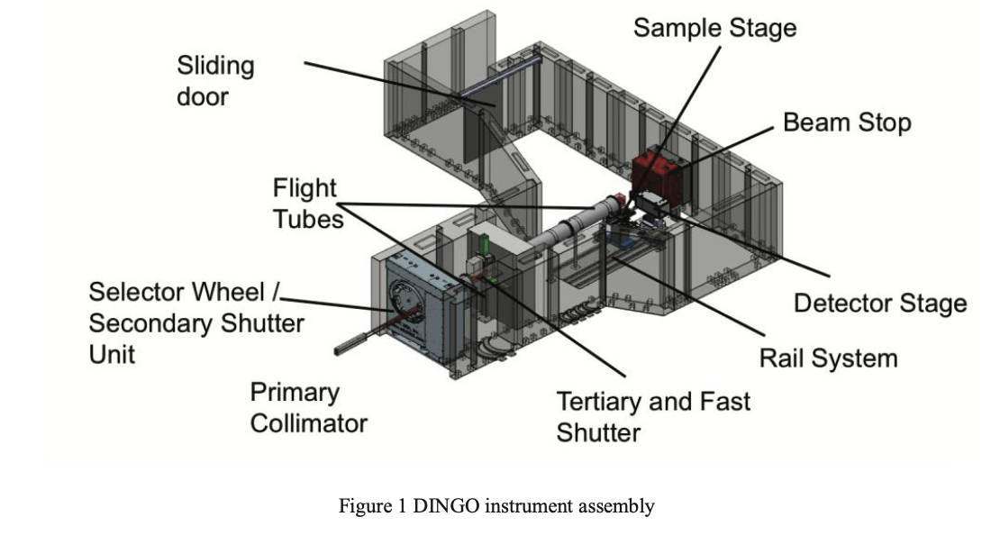



## 광학적 특성

| 시설 | 장치$^1$ | 빔 입사 단면적   ($\text{W cm}\times\text{H cm}$) | Aperture   (mm) | Flight Path | 기타
| :---:|:----:|:-----:|:-----:|:-----:|:-----:|
| NCNR | NG6 (C) | 6 x 7.5   58Ni 유도관 |  | 길이 : 9.5 m   ($\phi$ 30 cm) |
| HZB | CONRAD-2 (C) | 3 x 12   m=2, 2.5, 3 | 10 ~ 30  | 길이 : 12 m | illuminated area : 30 x 30 cm2 |
| PSI | ICON (C) |  | 1, 10, 20, 40, 80 | 
| OPAL | DINGO (T) | | |  | 50 × 50 ~ 200 × 200 mm2 [@Garbne2017Industrial]
: $^1$ (C) : 냉중성자 장치, (T) 열중성자 장치 {#tbl-hign_resolution_neutron_imaging_instrument_optical_properties}

## Layout

### ICONS

from @Kaestner2011ICON, 

 

### NCNR Cold Imaging

from @Hussey2025ColdNeutronImaging

### DINGO @ ANSTO

from @Garbne2017Industrial

## 검출기, 분해능

### 검출기 기술

From @Strobl2024NeutronImaging

- Binder materials 은 아래 두가지를 결합한다.
  - Neutron converter powders (like 6LiF or Gd2O3),
  - Scintillators (like ZnS:Ag) together. 

They must be transparent to visible light and mechanically flexible, typically relying on either organic polymers or inorganic materials.Common binder materials include:Organic Polymers: Silicone/Polydimethylsiloxane (PDMS), polystyrene, polypropylenes, and Perspex (PMMA). These are widely used to create flexible, large-area scintillator sheets or imaging plates.Inorganic Binders: Molten glasses (such as B₂O₃, PbO, or Bi₂O₃) or customized resins with a refractive index matched to the scintillator crystals to minimize light scattering.

### 실제 장치의 검출기 Spec

#### **ICON**

| Scintillator metrial and thickness | 6Li 50 μm  | 6Li 100 μm | Gd 10 μm | Gd 20 μm |
| :-----------------------------|-------:|-------:|-------:|-------:|
| Resolution (μm) | 39.4 | 42.4 | 20.3 | 27.8 |
: @Kaestner2011ICON {#tbl-ICONS_table_3}

#### **DINGO**

from @Garbne2017Industrial,

>Two detector systems are available on DINGO. A CCD camera (Andor IKON-L) for standard neutron radiography and tomography and a CMOS (Andor NEO 5.5 sCMOS) camera for fast data acquisition are running insimilar detector boxes. Both cameras are mounted at 90º from the beam direction; a mirror mounted at 45º is used to reflect the emitted light from the scintillation screen to the CCD. The scintillation screens are exchangeable. An initial set of six screens (3 in 200 200 mm2, 3 in 100 100 mm2) with different scintillation layer thickness (50µm-300 µm) is available. The scintillation screens are aluminum sheet with a thin layer of scintillation material(ZnS/6LiF) coated. The CCD or CMOS camera is mounted on a translation stage to adjust the field of view to the experimental conditions.

## References

::: {#refs}
:::

