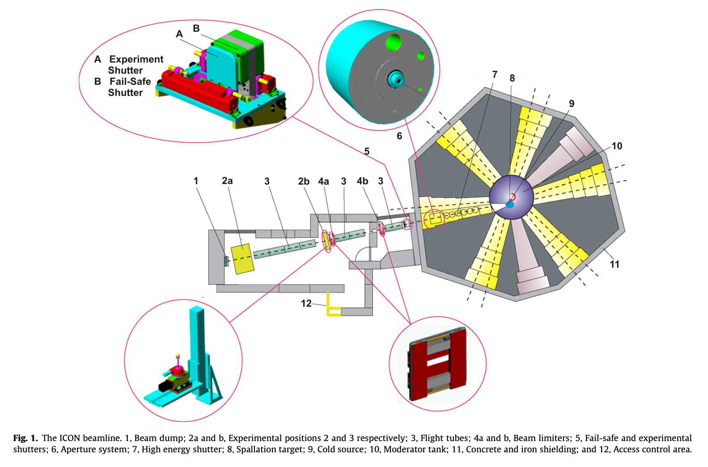
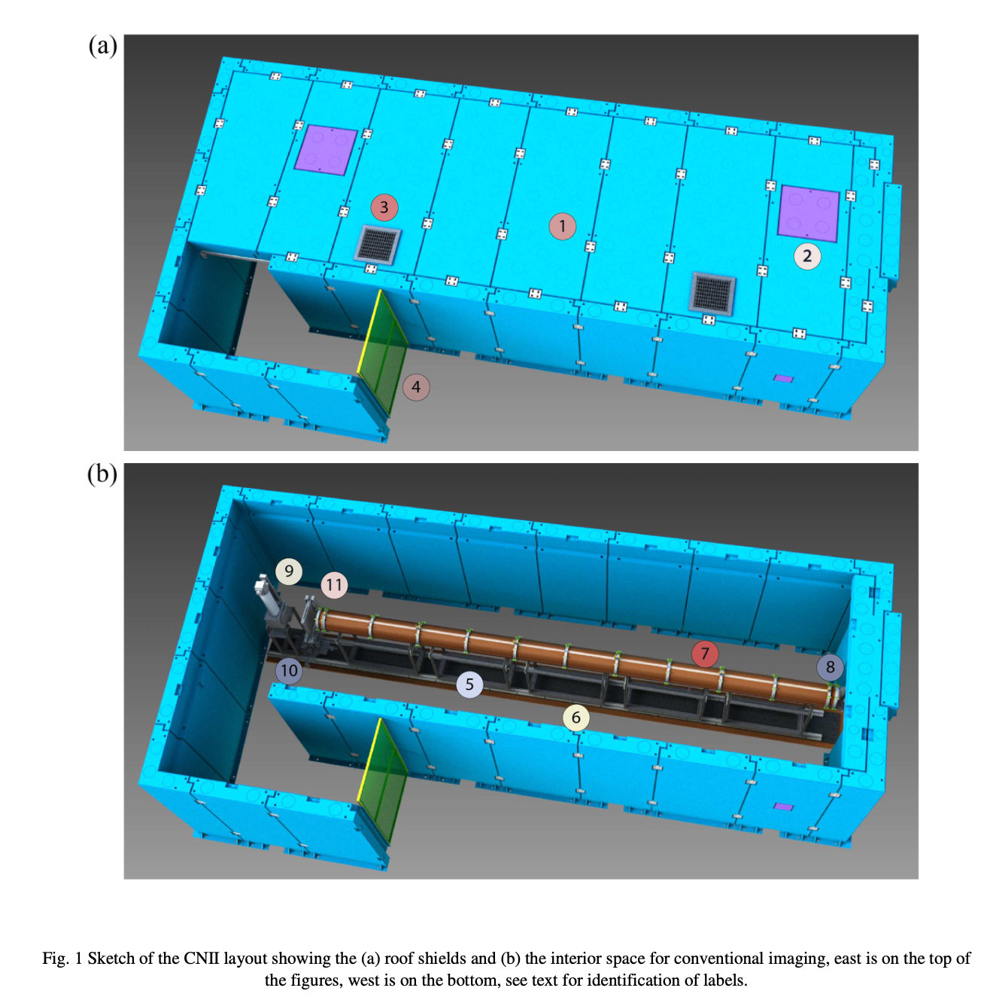



## 광학적 특성

| 시설 | 장치$^1$ | 빔 입사 단면적   ($\text{W cm}\times\text{H cm}$) | Aperture   (mm) | Flight Path | 기타
| :---:|:----:|:-----:|:-----:|:-----:|:-----:|
| NCNR | NG6 (C) | 6 x 7.5   58Ni 유도관 |  | 길이 : 9.5 m   ($\phi$ 30 cm) |
| HZB | CONRAD-2 (C) | 3 x 12   m=2, 2.5, 3 | 10 ~ 30  | 길이 : 12 m | illuminated area : 30 x 30 cm2 |
| PSI | ICON (C) |  | 1, 10, 20, 40, 80 | 
: $^1$ (C) : 냉중성자 장치, (T) 열중성자 장치 {#tbl-hign_resolution_neutron_imaging_instrument_optical_properties}

## Layout

### ICONS

from @Kaestner2011ICON, 

 

### NCNR Cold Imaging

from @Hussey2025ColdNeutronImaging

## 검출기, 분해능

| Scintillator metrial and thickness | 6Li 50 μm  | 6Li 100 μm | Gd 10 μm | Gd 20 μm |
| :-----------------------------|-------:|-------:|-------:|-------:|
| Resolution (μm) | 39.4 | 42.4 | 20.3 | 27.8 |
: @Kaestner2011ICON {#tbl-ICONS_table_3}