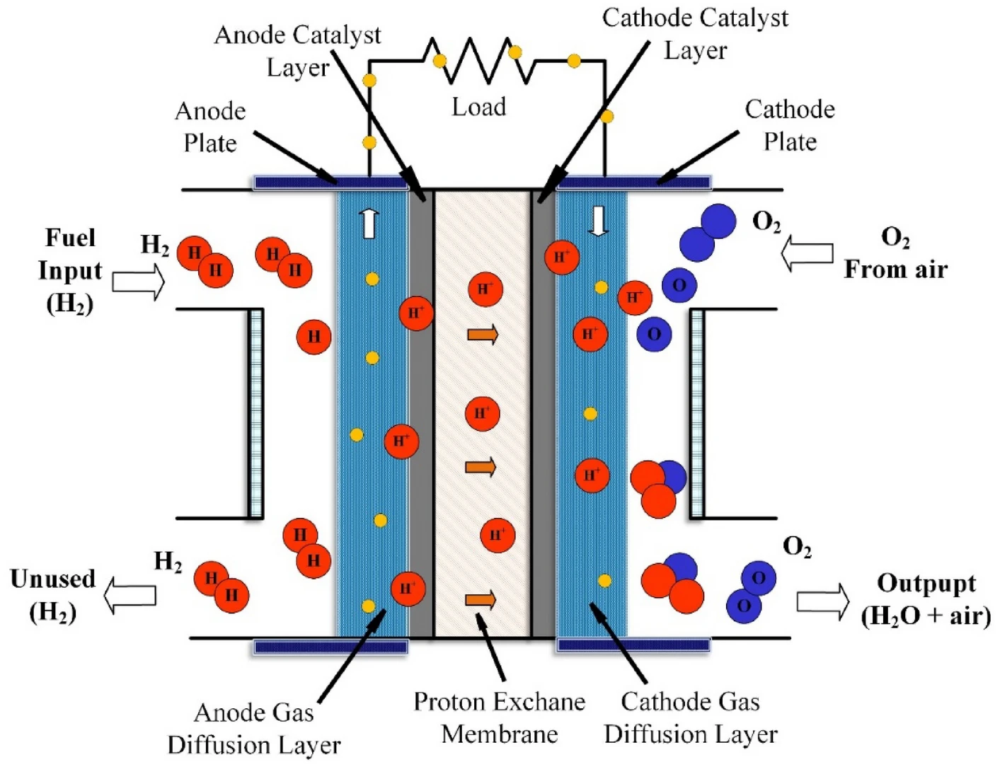



*Claude Opus 4.8 의 Research 를 이용하여 2026년 6월 25일 작성함*

## Introduction
- **연료전지는 연료(주로 수소)의 화학에너지를 연소 과정 없이 전기화학 반응으로 직접 전기로 변환하는 장치**로, 그중 **고분자 전해질막 연료전지(PEMFC)**는 저온(60–80 °C) 작동·빠른 시동·높은 출력밀도 덕분에 수소차와 분산발전의 핵심 기술로 자리잡았다.
- PEMFC의 성능을 좌우하는 가장 고전적이고 까다로운 문제는 **물 관리(water management)** — 막은 양성자 전도를 위해 수화되어야 하지만 과잉수는 기체 확산을 막아(flooding) 성능을 떨어뜨린다. **중성자 영상(neutron imaging)**은 수소/물에 강하게 산란하고 금속은 잘 투과하므로 작동 중 연료전지 내부의 물 분포를 비파괴로 보는 거의 유일한 도구이며, 본 보고서 독자의 향후 연구 분야와 직접 맞닿아 있다.
- 열역학적으로 H₂/O₂ 연료전지의 이론 기전력은 약 1.23 V, 이상 효율은 약 83%(LHV 기준 $\Delta G/\Delta H$)이며, 실제 전압은 활성화·옴·물질전달 과전압(분극 곡선의 세 영역)으로 인해 낮아진다.

 

## Key Findings

1. **정의와 차별성.** 연료전지는 배터리처럼 전기화학 셀이지만, 활물질$^1$을 내부에 저장하지 않고 외부에서 연료·산화제를 계속 공급받아 작동하는 "개방형" 발전기다. 열기관과 달리 화학에너지→열→일의 중간 단계를 거치지 않으므로 카르노 한계의 직접적 적용을 받지 않는다. [$^1$ 활물질(Active Material)은 이차전지 내부에서 충·방전 시 화학적 반응을 통해 실제로 전기 에너지를 생성하고 저장하는 핵심 물질]{.aside}
2. **작동 원리.** 양극(anode)에서 수소산화반응(HOR), 음극(cathode)에서 산소환원반응(ORR)이 일어나며, 전자는 외부 회로로(전류), 이온은 전해질을 통해 이동한다. PEMFC에서는 양성자(H+)가 막을 건넌다.
3. **열역학.** $\Delta G = −nFE$ 관계로부터 표준 기전력 $E^\circ ≈ 1.229\,\text{V}$ (액체 물 생성 기준)가 나오며, Nernst 식이 압력·온도 의존성을 준다.
4. **속도론과 실제 성능.** 분극(전류-전압) 곡선은 활성화 손실(저전류, ORR이 느림)·옴 손실(중간전류, 막 저항)·농도(물질전달) 손실(고전류, flooding)의 세 영역으로 나뉘며, Butler–Volmer 식이 전류와 과전압의 관계를 기술한다.
5. **PEMFC 구조.** 핵심은 막전극접합체(MEA): Nafion 등 과불화술폰산(PFSA) 막 + 백금/탄소 촉매층 + 기체확산층(GDL, 미세다공층 MPL 포함), 그 바깥에 분리판/유로(bipolar plate).
6. **백금 비용과 ORR.** ORR은 HOR보다 약 6자리수 느려 음극에 다량의 Pt가 필요하며, Sigma-Aldrich/Merck 기술 리뷰에 따르면 "PGM 촉매가 80 kW PEMFC 시스템 스택 총비용의 거의 절반(nearly half)"을 차지한다.
7. **중성자 영상.** NIST(BT-2), PSI(ICON/NEUTRA), ISIS(IMAT) 등에서 작동 중 PEMFC의 물 분포를 $\mu\text{m}$~수십 $\mu\text{m}$해상도, 초 단위 시간분해능으로 가시화하며, 최근 4D 중성자 CT까지 발전했다.
8. **다른 연료전지.** SOFC(고온 세라믹, O2- 전도), MCFC(용융탄산염, CO32-), PAFC(인산), AFC(알칼리, OH-), DMFC(직접 메탄올)가 작동온도·전해질·전하운반체·용도에서 차이를 보인다.
9. **현황.** PEMFC는 토요타 미라이·현대 넥쏘 등 상용 수소차의 표준 기술이지만, 수소 인프라·내구성·비용 문제로 FCEV 판매는 최근 둔화되었고, 정치(stationary) 발전 분야가 새 성장축으로 부상 중이다.

 

## Details

### 연료전지란 무엇인가: 정의·역사·차별성

**정의.** 연료전지(fuel cell)는 연료의 화학에너지를 전기화학 반응을 통해 직접 전기에너지로 변환하는 발전 장치다. 수소를 연료로 쓰는 경우 부산물은 물과 열뿐이며, 작동 중 CO2나 질소산화물·황산화물 같은 오염물질을 배출하지 않는다.

**역사.** 연료전지의 기원은 1839년 영국(웨일스 출신)의 윌리엄 그로브(Sir William Robert Grove, 1811–1896)로 거슬러 올라간다. 그는 물 전기분해의 역과정 — 수소와 산소를 결합해 전기를 만드는 것 — 을 착안하여 묽은 황산 전해질에 백금 전극을 담근 **가스 전지(gas voltaic battery)** 를 만들었다(1842년 50셀 묶음 시연). 1800년 니컬슨과 칼라일의 전기분해 발견에서 영감을 얻었다. 그로브는 "연료전지의 아버지"로 불린다. 이후 100여 년간 실용성이 낮았으나, 1932년 프랜시스 베이컨(Francis T. Bacon)이 알칼리형 연료전지(AFC)를 개발했고, 1960년대 NASA가 아폴로·우주왕복선 계획에서 전력·식수원으로 채택하면서 본격 발전했다.

**배터리와의 차이.** 배터리는 활물질을 셀 내부에 저장하는 폐쇄형 에너지 저장 장치로, 방전되면 충전(또는 교체)해야 한다. 반면 연료전지는 연료와 산화제가 외부에서 공급되는 한 계속 전기를 생산하는 변환 장치다(자동차로 치면 연료탱크에 계속 주유하는 것과 같다). 즉 연료전지는 "에너지 변환기", 배터리는 "에너지 저장기"다.

**열기관(내연기관)과의 차이.** 내연기관은 연료를 연소시켜 열을 만들고, 그 열로 기계적 일을 한 뒤 발전한다(화학→열→기계→전기). 각 단계마다 손실이 있고, 특히 열→일 단계는 카르노 효율의 제약을 받는다. 연료전지는 화학에너지를 전기로 직접 변환하므로 중간 단계 손실이 적다. Argonne 연구소의 실측에서 2016년형 토요타 미라이의 차량 평균 효율은 25 °C에서 약 62%로, 동급 하이브리드(약 46%)·일반 내연기관차(약 24%)를 크게 앞섰다.

 

### 작동 원리: 반쪽반응과 전자·이온의 흐름

PEMFC(Polymer Electrolyte Membrane Fuel Cell)의 경우:

{#fig-PEMFC width=400}

- **양극(anode), 수소산화반응(HOR):** $\text{H}_2 \to 2\text{H}^+ + 2e^-$

- **음극(cathode), 산소환원반응(ORR):** $\frac{1}{2}\text{O}_2 + 2\text{H}^+ + 2e⁻ \to \text{H}_2\text{O}$

- **전체 반응:** $\text{H}_2 + \frac{1}{2}\text{O}_2 \to \text{H}_2\text{O} (+ \text{전기} + \text{열})$

수소가 양극 촉매에서 양성자와 전자로 분리되면, **양성자($H^+$)는 전해질막(electrolite membrane)을 통해** 음극으로 이동하고, **전자($e^-$)는 막을 통과하지 못해 외부 회로를 따라** 흐르며 이 흐름이 곧 전류이다. 음극에서 전자·양성자·산소가 만나 물을 생성한다. 전해질의 종류에 따라 운반되는 이온이 달라진다(PEMFC·PAFC: $\text{H}^+$, AFC: $\text{OH}^-$, SOFC: $\text{O}^{2-}$, MCFC: $\text{CO}_3^{2-}$).

 

### 열역학: 깁스 자유에너지, 기전력, Nernst 식, 효율

**$\Delta G$ 와 기전력.** 전기화학 셀이 할 수 있는 최대 전기적 일은 반응의 깁스 자유에너지 변화 $\Delta G$와 같다. 전하량 $nF$($n$: 이동 전자 몰수, $F$: 패러데이 상수 96,485 C/mol)당 전위로 환산하면

$$
\Delta G = −nFE
$$

$\text{H}_2 + \frac{1}{2}\text{O}_2 \to \text{H}_2\text{O} (l)$ 반응은 25 °C에서 $\Delta G^\circ = −237.2 \text{kJ/mol}$, $\Delta H^\circ = −285.8 \text{ kJ/mol}$ 이다. 따라서 표준 가역 기전력은

&nbsp;&nbsp;$E^\circ = - \Delta G^\circ/(nF) =  237,200 / (2 × 96,485) \approx \textbf{1.229 V}$ (액체 물 생성 기준; 기체 물 기준 $\sim 1.18 \text{ V}$).

$\Delta G$ 는 온도가 올라가면 (엔트로피 항 $−T\Delta S$ 때문에) 감소하므로 이상 전압도 온도에 따라 낮아진다. 반응이 $\Delta S < 0$ (기체 분자 수 감소)이기 때문이다.

#### **Nernst 식** 

비표준 조건(압력·농도)에서의 기전력은

$$
E=E^\circ - (RT/nF)\ln Q, \qquad \text{where } Q= \dfrac{p(\text{H}_2\text{O})}{[p(\text{H}_2)\cdot p(\text{O}_2)^{1/2}]}
$$

로 주어진다. 반응물($\text{H}_2$, $\text{O}_2$) 분압이 높을수록, 생성물($\text{H}_2\text{O}$) 분압이 낮을수록 전압이 올라간다. 가압 운전이 성능에 유리한 열역학적 근거다.

#### **열역학 효율과 카르노 비교.** 

연료전지의 이상(가역) 효율은 전기로 변환 가능한 $\Delta G$ 와 연료의 총 발열량 $\Delta H$ 의 비로 정의된다:

$$
\eta_\text{max} = \dfrac{\Delta G}{\Delta H} = \dfrac{237.2}{285.8} \approx 0.83. \qquad (\text{저위발열량 LHV 기준, 25 \%})
$$

이 값은 흔히 **연료전지는 카르노 한계에 묶이지 않는다** 는 말로 표현된다. 다만 학술적으로는 미묘한 논쟁이 있다: 일부 연구자(예: Haseli, *Int. J. Hydrogen Energy* 2018)는 동일 고온·저온 사이에서 비교하면 연료전지와 열기관 모두 열역학 제2법칙이라는 같은 한계에 묶인다고 본다(해당 논문은 $\text{H}_2-\text{O}_2$ 79.3%, $\text{H}_2$-공기 75.7%, 메탄-공기 82.1%의 이상 효율을 도출). 실용적 핵심은 **저온에서 연료전지가 동급 온도의 열기관보다 훨씬 높은 효율을 낼 수 있다**는 점이다. 실제 시스템 효율은 50–60%대다.

 

### 속도론과 실제 성능: 분극 곡선과 과전압

이상적으로는 1.23 V 여야 하지만, 실제 셀은 전류를 흘리는 순간 전압이 떨어진다. **분극 곡선(polarization curve, i–V curve)**은 전류밀도에 따른 셀 전압을 보여주며, 손실의 종류에 따라 세 영역으로 나뉜다.

1. **활성화 과전압(activation overpotential, 저전류 영역).** 전극 반응 자체가 느려서 반응을 일으키는 데 필요한 "활성화 장벽"을 넘기 위해 잃는 전압이다. PEMFC에서는 특히 **음극 ORR이 매우 느려**(양극 HOR보다 약 6자리수 느림) 활성화 손실의 대부분을 차지한다. 이 손실은 개회로에서도 0.1–0.2 V에 달해 실제 개회로 전압을 1.0 V 이하로 끌어내린다.
2. **옴 손실(ohmic loss, 중간전류 영역).** 막의 이온 저항과 전극·분리판의 전자 저항에 의한 IR 강하로, 옴의 법칙(ΔV = iR)을 따라 전류에 선형 비례한다. 막 수화 상태가 이 영역을 좌우한다.
3. **농도(물질전달) 과전압(concentration loss, 고전류 영역).** 전류가 커지면 반응물(특히 $\text{O}_2$)이 촉매 표면에 충분히 빨리 도달하지 못해 전압이 급락한다. **물 범람(flooding)**으로 기체 통로가 막히면 이 손실이 심해진다.

**Butler–Volmer 식.** 활성화 영역의 전류밀도 i와 과전압 η의 관계는 전기화학 속도론의 기본식인 Butler–Volmer 식으로 기술된다:

$$
i = i_0 \left[\exp (\alpha_a F \eta/RT) - \exp (-a_c F\eta/RT)\right].
$$

여기서 $i_0$ 는 교환전류밀도(반응의 본질적 빠르기, ORR은 $i_0$ 가 매우 작다), $\alpha$ 는 전하전달계수이다. 과전압이 충분히 크면 한쪽 지수항이 지배해 **Tafel 식**($\eta = a + b \log i$) 으로 단순화된다. ORR은 $i_0$ 가 작은(즉 느린) 반응이고, Butler–Volmer 상 같은 출력을 내려면 큰 과전압을 감수하거나 $i_0$ 를 키워야 하는데, $i_0$ 를 키우는 현실적 방법이 촉매 표면적을 늘리는 것이라 cathode에 백금을 다량 투입하게 된다.

 

### PEMFC 상세

#### **막전극접합체(MEA)와 전체 구조**

{#fig-PEMFC_2 width=400}

PEMFC 단위 셀은 안쪽부터 **고분자 전해질막 — 촉매층(양쪽) — 기체확산층(GDL, 양쪽) — 분리판/유로** 로 구성된다. 막+촉매층+GDL을 합친 것이 MEA(membrane electrode assembly)로, 실제 전기화학 반응이 일어나는 심장부다. 셀 하나의 전압은 1 V 미만이므로, 실제 스택(stack)은 수백 장의 셀을 분리판으로 직렬 연결해 필요한 전압을 얻는다.

#### **고분자 전해질막: Nafion의 화학과 양성자 전도**

가장 널리 쓰이는 막은 듀폰(현 Chemours)이 1960년대 개발한 **Nafion**, 곧 과불화술폰산(PFSA) 이오노머다. 구조는 **테플론(PTFE) 같은 소수성 불소탄소 주쇄에 술폰산기($–\text{SO}_3\text{H}$)로 끝나는 친수성 곁사슬**이 달린 형태다. 막을 특징짓는 두 지표는 두께와 당량(equivalent weight, EW: 술폰산기 1몰당 건조 고분자 질량)이다. 예컨대 Nafion 117은 EW 1100, 두께 약 178 µm이고, Nafion 112는 같은 EW에 약 51 µm다.

주사슬(소수성)와 곁사슬(친수성)의 극성 차이로 **나노 상분리**가 일어나, 술폰산기가 안쪽 벽을 이루는 직경 약 4–6 nm의 물 채널(나노클러스터)이 형성된다. 물이 흡수되면 술폰산기가 해리되어 양성자를 내놓고, 이 양성자가 채널을 통해 전도된다. 완전 수화된 Nafion 117의 양성자 전도도는 약 0.09–0.16 S/cm(액체 물 평형, 측정법에 따라 다름)이며, 흔히 80 °C 완전 수화 기준 **~0.1 S/cm**가 벤치마크로 인용된다. 전도도는 함수율(술폰산기당 물 분자 수) $\lambda$ 에 강하게 의존하며, $\lambda$ 가 낮으면(특히 $\lambda < 5$) 급격히 떨어진다.

**양성자 전도 메커니즘: Grotthuss vs 운반(vehicular)**

- **Grotthuss(구조 확산/호핑) 메커니즘:** 양성자가 물 분자(또는 술폰산기) 사이의 수소결합을 끊고 새로 만들며 "건너뛰듯" 이동한다. 운반체 분자 자체의 이동 없이 양성자 환경의 재배열만으로 전하가 전달되므로 빠르다.

- **운반(vehicular) 메커니즘:** 양성자가 물 분자에 붙어 하이드로늄 이온($\text{H}_3\text{O}^+$) 형태로 물과 함께 통째로 확산한다. 물의 이동이 필수적이다.

Nafion에서는 두 기구가 공존·협력하며, 수화도가 높을수록 잘 연결된 물 채널을 통한 전도가 활발해진다. 1806년 Theodor Grotthuss가 처음 제안한 호핑 기구는 잘 수화된 물에서 양성자 전도를 빠르게 만드는 핵심이다. Kreuer 등의 연구에 따르면 완전 수화 시 Grotthuss(구조 확산)가 약 2.5배의 증폭 인자를 주는 반면, 저수화에서는 운반(vehicular) 기구가 지배한다. 이 때문에 **막의 수화 유지가 PEMFC 성능의 절대 조건**이며, 곧 물 관리 문제로 직결된다.

#### **촉매층: 백금/탄소와 ORR의 난제**

촉매층은 탄소 분말(예: Vulcan XC-72)에 백금 나노입자를 담지한 $\text{Pt/C}$와 이를 묶는 이오노머(보통 Nafion 용액)로 이루어진다. **양극(HOR)은 빠르지만, 음극(ORR)은 약 5–6자리수 느려** 음극에 더 많은 백금이 필요하다. 미국 DOE는 2017년 기준 백금족 금속(PGM) 총담지량을 2020년까지 0.125 mg/cm²(정격 1.0 W/cm² 기준 약 0.125 g/kW) 미만으로 낮추는 목표를 세웠고, 실험실 수준에서 0.1–0.125 mg/cm²까지 내려왔다. 비용 측면에서, 2024년 ChemElectroChem 리뷰(Krishnan 등)에 따르면 고생산량 시나리오에서도 "Pt 계열 촉매가 여전히 스택 총비용의 최소 26%(at least 26%)"를 차지하며, Sigma-Aldrich/Merck 기술 리뷰는 80 kW급 시스템에서 PGM 촉매가 "스택 총비용의 거의 절반(nearly half)"을 차지한다고 본다. 또한 2020년 추산으로 80 kW급 자동차용 PEMFC 시스템(연 10만 대 생산) 비용은 내구성 보정 시 &dollar;76/kW_net로, DOE의 2025년 목표  &dollar;40/kW_net를 웃돌았다. Pt 합금(Pt-Co 등)으로 담지량을 0.4→0.2 mg/cm²로 줄이거나, 전이금속-질소-탄소(M-N-C) 같은 비귀금속 촉매(PGM-free)를 개발하는 연구가 활발하다.

#### **기체확산층(GDL)과 미세다공층(MPL)**

GDL은 보통 탄소섬유 종이(carbon paper) 또는 탄소천(carbon cloth)으로, 두께 약 100–300 µm, 공극률 70–80%다. 역할은 (1) 유로의 반응 기체를 촉매층 전면에 고르게 확산, (2) 생성수 배출, (3) 전자·열 전도, (4) MEA 기계적 지지다. 통상 **PTFE로 소수성 처리**해 물이 공극을 막지 않게 한다. 촉매층과 맞닿는 면에는 탄소 분말+PTFE로 만든 얇은 **미세다공층(MPL)**을 두어 물 배출과 계면 접촉을 개선한다. GDL의 미세구조·소수성·두께는 flooding과 막 건조 사이의 균형을 좌우하는 핵심 설계 변수다.

#### **분리판과 유로 설계**

분리판(bipolar plate)은 인접 셀의 전기를 연결하고, 표면에 새겨진 유로(flow field)로 반응 기체를 분배하며 생성수를 배출하고 열을 관리한다. <u>흑연·코팅 금속·복합재가 쓰이며</u>, 유로 형태(serpentine, parallel, interdigitated 등)에 따라 기체 분배 균일성·물 배출·압력 강하가 달라진다. 분리판은 기존 스택 중량의 상당 부분을 차지해 경량화 연구가 진행된다.

#### **작동 조건과 물 관리: PEMFC의 핵심 딜레마**

PEMFC는 보통 **60–80 °C**의 저온에서 작동하며, 막이 마르지 않도록 반응 기체를 가습한다(물이 형성되는 속도보다 빨리 증발하면 안 되므로 100 °C 미만 운전). 물 관리의 본질적 딜레마는 다음과 같다:

- **막은 젖어 있어야 한다:** 양성자 전도(특히 Grotthuss)는 충분한 물($\lambda \ge 5$ 에서 술폰산기 완전 해리)을 요구한다. 막이 마르면 옴 저항이 급증한다.
- **그러나 물이 너무 많으면 안 된다:** 액체 물이 GDL 공극과 유로를 막으면(flooding) 산소가 촉매에 도달하지 못해 농도 과전압이 급증한다.

이 균형을 더 복잡하게 만드는 것이 막 내 물의 두 가지 흐름이다:

- **전기삼투 끌림(electro-osmotic drag, EOD):** 양성자가 막을 건널 때 물 분자를 양극→음극으로 끌고 간다. Zawodzinski 등(*J. Electrochem. Soc.* 1993)의 고전적 측정에 따르면 Nafion 117에서 끌림 계수 $\xi$(양성자당 물 분자 수)는 증기 평형 막($\lambda$=1.4–14, 30 °C)에서 약 1.0, 액체 평형 막에서 약 2.5에 이르며(Springer 모델의 기준점 ($\xi_1,\, \lambda_1$)=(2.5, 22)), 작동 셀 실측치는 보통 0.5–1.0 범위로 보고된다. $\lambda$ 가 5 미만이면 $\xi$ 는 0에 가까워진다. 문헌 간 산포가 커서 단일 값이 아닌 범위로 이해해야 한다(Vetter & Schumacher, arXiv:1811.10091은 "신뢰할 만한 $\xi(\lambda,T)$ 상관식이 아직 없다"고 명시).

- **역확산(back-diffusion):** 음극에서 생성·축적된 물이 농도 구배를 따라 음극→양극으로 되돌아간다.

순(net) 물 이동은 EOD에서 역확산을 뺀 값이다. 고전류에서는 EOD가 막의 음극 측을 적시고 양극 측을 마르게 하는 경향이 있어, 막 두께를 줄이면(예: Nafion 211, ~25 µm) 역확산이 강해져 물 분포가 균일해진다. 함수율 $\lambda$ 는 액체 평형에서 약 14, 액침 모델링값 약 22로 차이를 보이는 "Schroeder의 역설"($λ_\text{liquid} \approx 22$ vs $\lambda_\text{vapor} \approx 14$)로 알려져 있으나, 이는 부분적으로 막 전처리(고온 진공 건조 등)에 따른 인공산물이라는 반론도 있다.

#### **내구성·열화와 비용**

상용화의 3대 과제는 비용·성능·내구성이다. 주요 열화 기구:

- **백금 열화:** Pt 입자의 응집(Ostwald ripening), 용해·재석출, 막으로의 이동 — 전기화학적 활성표면적(ECSA) 감소. 한 연구에서 전압 사이클링 시 ECSA가 최대 40% 감소하고 입자가 20% 이상 성장했다. 촉매층 열화 정량 연구에서는 초기 100시간 동안 Pt 입자 응집이 열화의 약 80%를 차지하고, 225–650시간 구간에서는 촉매 용해·이오노머의 양성자 연결 상실이 23→46%로 증가했다.

- **탄소 담지체 부식:** 특히 시동·정지(start/stop) 시 양극의 수소/공기 경계가 만드는 역전류로 음극 탄소가 부식된다.

- **막 화학적 열화:** 라디칼 공격으로 막이 얇아지고 핀홀이 생겨 스택 고장으로 이어진다. 막 열화는 촉매 열화(초기 수백 시간 후 안정화)와 달리 수명 내내 누적·가속된다.

차세대 PEMFC의 핵심 지표로 **출력밀도**가 강조된다(Jiao 등, *Nature* 595, 2021, 361). 일본 NEDO의 공식 로드맵은 차량용 FC 출력밀도 목표로 **2030년 6 kW/L(셀 전압 >0.6 V, 시스템 비용 <US$40/kW, 주행 800 km), 2040년 9 kW/L(0.85 V, US$20/kW, >1,000 km)**를 제시했다. 토요타 2세대 미라이(2020) 스택은 부피를 33→24 L로 줄여 **약 5.4 kW/L(엔드플레이트 포함, 세계 최고 수준; 제외 시 약 4.4 kW/L)**의 부피 출력밀도를 달성했다 — 1세대(2014)의 3.1 kW/L에서 크게 향상된 값이다.

 

### 중성자 영상으로 보는 PEMFC 물 거동 (독자 연구분야 연결)

#### **왜 중성자인가**

X선은 원자번호(전자 밀도)에 따라 감쇠하므로 가벼운 원소(수소·물)와 배경(탄소·금속)의 대비가 약하다. 반면 **중성자는 원자핵과 상호작용하며 수소에 의해 매우 강하게 산란**되고, 알루미늄·흑연 같은 금속·탄소 구조재는 잘 투과한다. 따라서 금속 분리판으로 둘러싸인 작동 중 연료전지 안의 물(H₂O)을 비파괴로 가시화하는 데 중성자가 이상적이다. NIST는 "중성자 영상이 PEMFC 연구에 가장 중요한 진단법의 하나로 입증되었다"고 평가한다. 이는 중성자 영상의 대표적 "킬러 애플리케이션"으로 꼽힌다.

#### **라디오그래피 vs 토모그래피**

- **중성자 라디오그래피(radiography):** 2D 투과 영상. 빠른 시간분해능으로 작동 중 물의 생성·이동·배출 동역학을 실시간 추적할 수 있다(예: 2초 간격 1000장으로 동영상 구성). 막면에 수직(through-plane) 또는 평행(in-plane) 방향으로 촬영해 GDL/유로/막의 물을 구분한다.

- **중성자 토모그래피(tomography):** 여러 각도 투영을 재구성한 3D 영상. 구조 결함·3D 물 분포를 볼 수 있으나, 전통적으로 노출에 수 시간이 걸려 동적 측정이 어려웠다. 최근에는 제한 투영·고급 재구성으로 한계를 넘고 있다.

#### **주요 시설과 분해능**

- **NIST 중성자 영상 시설(미국, BT-2):** 2006년부터 국가 사용자 시설로 운영. PEMFC의 관심 영역인 막(두께 ~50 µm)을 보기 위해 물 두께 10–50 µm 민감도, 공간분해능 ~200 µm 이하, 빠른 영상 취득을 설계 목표로 했다. 2016년 도입된 NIST-NeXT는 중성자/X선 동시 토모그래피를 가능케 했다.

- **PSI(스위스, SINQ의 ICON·NEUTRA 빔라인):** 연료전지에 유리한 냉중성자(ICON)와 열중성자(NEUTRA)를 제공. 평면(in-plane) 고해상 영상에서 픽셀 분해능 2.5 µm까지 달성했다. 일반 연료전지 실험에서 ~10–50 µm 공간분해능, 30초 이하 노출이 보고된다.

- **ISIS(영국, IMAT 빔라인, Rutherford Appleton Lab):** 펄스 중성자원. ZnS/LiF 신틸레이터와 sCMOS 카메라(2048×2048), 시야 약 211×211 mm², 25 cm²·100 cm² 셀 전면 촬영이 가능하다(콜리메이션비 L/D≈260, 중성자 파장 0.7–6.7 Å).

#### **최근(2020+) 연구 사례**

- **고속 4D 중성자 CT (Ziesche 등, *Nature Communications* 2022, 13:1616, DOI 10.1038/s41467-022-29313-5):** 3D + 시간 분해 중성자 단층촬영을 처음 구현해, 작동 중 PEFC의 국소 물 변화를 정량화하고 유로 내 물방울 형성을 추적했다. 이로써 유로 설계별 물 관리 성능 지표를 정의했다.

- **도마뱀 피부 모사 유로 + 운영 중 중성자 영상 (Xu 등, *Advanced Science* 2024, 11:2404350, ISIS IMAT):** 사막 도마뱀의 모세관 미세채널을 모사한 유로가 25 cm² 셀에서 최대 출력밀도를 15%, 100 cm² 셀에서 13% 향상시켰고, 중성자 라디오그래피로 물 배출 개선을 확인했다. 건조 조건·400 mA/cm²에서 도마뱀 모사 7중-사형(septuple-serpentine) 유로는 기존 대비 500초 후 액체 물 155 mg을 덜 생성했다.

- **프랙탈 금속폼 유로 (Wu 등, *Applied Energy* 2024):** 운영 중 중성자 영상으로 더 균일한 물 분포를 확인하고 성능을 약 15% 개선했다.

- **EIS + 중성자 영상 동기 측정 (ISIS IMAT, *Cell Reports Physical Science* 2024):** 임피던스와 중성자 영상을 동시 측정해 막·셀 함수량을 정량화하는 방법론을 제시했다.

중성자 영상의 한계는 **공간분해능(검출기에 의해 제한)**이며, GDL 공극 내부 물을 µm 단위로 보려면 싱크로트론 X선 영상(수 µm)이 상보적으로 쓰인다. 두 기법의 결합이 추세다.

 

### 다른 연료전지 종류와 비교

| 종류 | 전해질 | 전하운반체 | 작동온도 | 촉매 | 주 연료 | 장점 | 단점 | 주 용도 |
|---|---|---|---|---|---|---|---|---|
| **PEMFC** | 고분자막(Nafion 등) | H⁺ | 60–80 °C | Pt/C | 순수소 | 저온·빠른 시동·고출력밀도 | Pt 비용, 물 관리, 순수소 필요 | 수소차, 휴대·분산전원 |
| **AFC** | KOH 수용액 | OH⁻ | 약 70–120 °C | 비귀금속 가능 | 순수소 | 고효율, 비백금 가능 | CO₂에 민감(공기 정제 필요) | 우주(아폴로·우주왕복선) |
| **PAFC** | 인산 | H⁺ | 약 150–210 °C | Pt | 수소(개질가스) | 성숙·내구성, CHP | 낮은 출력밀도, 고가 | 정치형 발전·CHP |
| **MCFC** | 용융 탄산염(Li/K) | CO₃²⁻ | 약 600–650 °C | 비귀금속(Ni) | 수소·천연가스 | 내부 개질, 고효율 | 긴 시동, 부식, CO₂ 필요 | 대형 정치 발전(MW급) |
| **SOFC** | 세라믹(YSZ 등) | O²⁻ | 약 600–1000 °C | 비귀금속(Ni) | 수소·천연가스·탄화수소 | 연료 유연성, 50–60% 효율, 폐열 활용 | 긴 시동, 고온 소재 문제 | 정치 발전(kW–MW) |
| **DMFC** | 고분자막 | H⁺ | 약 60–120 °C | Pt-Ru/Pt | 메탄올(직접) | 액체연료·고에너지밀도·개질 불필요 | 메탄올 크로스오버, 낮은 효율 | 휴대전원·소형기기 |

 

핵심 경향: **작동온도가 낮을수록(PEMFC·AFC) 빠른 시동·휴대성에 유리하나 귀금속 촉매가 필요**하고, **높을수록(MCFC·SOFC) 비귀금속 촉매와 연료 유연성·폐열 활용이 가능하나 시동이 느리고 소재 부담이 크다.** SOFC 전해질로는 이트리아 안정화 지르코니아(YSZ)가 표준이며 산소 이온($\text{O}^{2-}$)을 전도한다. DMFC는 PEMFC의 변형으로, 메탄올을 직접 산화하지만 메탄올이 막을 건너 음극을 오염시키는 크로스오버가 최대 난제다(연료 효율을 떨어뜨리고 음극에 혼합 전위를 형성). MCFC·SOFC는 고온 덕에 천연가스의 내부 개질이 가능해 연료 유연성이 높다.

 

### 응용과 현황 (2020–2025)

#### **수소차(FCEV)** 
PEMFC는 토요타 미라이, 현대 넥쏘, 혼다 등 상용 수소차의 표준 기술이다. 2세대 미라이(2020)는 IFPEN 벤치 측정에서 스택 LHV 효율이 저부하에서 약 70%, 시스템 효율 약 62%에 달하고, 최대 출력 부근에서 각각 ~54%, ~46%로 떨어진다. 미라이의 충전 시간은 약 3분, 항속거리는 약 650 km(WLTP)/402마일(EPA XLE)이다. 현대는 2024년 10월 차세대 FCEV 콘셉트 'INITIUM'(목표 항속 650 km 이상)을 공개했다.

#### **시장 동향** 

그러나 FCEV 승용차 판매는 최근 둔화됐다 — IDTechEx의 *Fuel Cell Electric Vehicles 2025-2045* 보고서에 따르면 연간 판매가 "2022년 약 15,000대에서 2024년 약 5,000대로 약 2/3(approximately two-thirds) 감소"했다. 원인은 비싸고 불안정한 수소충전소, BEV의 빠른 발전, 모델 부족이다. 같은 기간 BEV 승용차는 1,100만 대를 넘게 팔렸다. 반면 **정치형(stationary) 연료전지**가 성장축으로 부상해, 2024년 수소 연료전지 시장에서 정치 부문이 약 53%를 차지했다(market.us). PEMFC는 전체 연료전지 기술 중 최대 점유율(약 33%)을 유지한다. 한국과 미국 캘리포니아가 FCEV 보급을 주도해 왔고, 트럭·버스 등 상용차와 중량 운송이 FCEV의 유력 시장으로 꼽힌다.

#### **과제** 

(1) **수소 인프라:** 충전소가 미·중·일·한·독 등 일부 국가에 한정. 

(2) **비용:** 백금 촉매·분리판·스택 제조비. 

(3) **내구성:** 동적 운전·시동정지에 따른 열화. 

(4) **청정수소:** 현재 대부분 천연가스 개질("그레이 수소")로 만들어 CO₂를 배출하므로, 재생에너지 기반 "그린 수소"가 있어야 FCEV의 친환경성이 성립한다.

 

## Recommendations

**독자(고체물리 박사, 중성자 영상 지향)를 위한 단계적 학습·연구 경로:**

1. **1단계 — 기초 다지기 (1–2주):** O'Hayre 등의 *Fuel Cell Fundamentals*로 열역학(ΔG=−nFE, Nernst)·속도론(Butler–Volmer, 분극 곡선)을 다지고, Larminie & Dicks의 *Fuel Cell Systems Explained*로 시스템 관점을 잡는다. 고체물리 배경이 있으므로 Nafion 나노상분리·양성자 전도 메커니즘(Grotthuss vs vehicular) 부분은 응집물질 관점에서 빠르게 흡수 가능하다.
2. **2단계 — PEMFC·물 관리 심화 (2–4주):** Jiao 등의 *Nature* 595 (2021) 361 리뷰("Designing the next generation of PEMFCs")로 최신 MEA·물/열 관리 과제를 파악하고, *Int. J. Hydrogen Energy*의 물 관리 리뷰(Wang 등, 2020/2021)와 Wang 등 *Energy Environ. Sci.* 15 (2022) 2288(PEM 연료전지·전해·수소 인프라 리뷰)을 읽는다.
3. **3단계 — 중성자 영상 직접 연결 (핵심):** NIST·PSI·ISIS의 연료전지 중성자 영상 방법론 논문과 최근 4D CT(Ziesche 등, *Nat. Commun.* 2022), operando 연구(Xu 등, *Adv. Sci.* 2024)를 정독한다. **벤치마크 지표**로 공간분해능(목표 <50 µm), 시간분해능(초~프레임 단위), 물 두께 민감도(10–50 µm)를 잡고, X선(싱크로트론) 영상과의 상보성을 염두에 둔다.
4. **실험 설계 시:** through-plane(물의 막 수직 분포)과 in-plane(활성면 전체 물 분포) 중 연구 질문에 맞는 기하를 선택하고, 셀 소재를 중성자 친화적(알루미늄 등)으로 설계한다. EIS 등 전기화학 진단과 동기 측정하면 물 분포–성능 상관을 정량화할 수 있다(ISIS IMAT 2024 사례 참고).

**판단을 바꿀 기준점(thresholds):** 만약 연구 목표가 GDL 공극 내부 물을 µm 단위로 분해하는 것이라면 중성자 단독으로는 부족하므로 싱크로트론 X선과 결합해야 한다. 반대로 대면적 셀 전체의 물 동역학을 실시간으로 보는 것이 목표면 중성자 라디오그래피가 최적이다.

**한국어·영어 추천 자료:**

- 영어 교과서: J. Larminie & A. Dicks, *Fuel Cell Systems Explained*; R. O'Hayre 등, *Fuel Cell Fundamentals*; F. Barbir, *PEM Fuel Cells: Theory and Practice*.

- 영어 리뷰/논문: Jiao 등, *Nature* 595 (2021) 361; Wang 등, *Energy Environ. Sci.* 15 (2022) 2288; *J. Power Sources*, *Int. J. Hydrogen Energy*의 물 관리·GDL·촉매 리뷰; 중성자 영상은 Ziesche 등(*Nat. Commun.* 2022), Xu 등(*Adv. Sci.* 2024).

- 기관 자료: 미국 DOE Hydrogen and Fuel Cell Technologies Office, NREL, NIST Neutron Imaging 자료.

- 한국어 자료: KOCW 공개강의(연료전지 종류·PEMFC 핵심소재), CHERIC(화학공학소재정보은행)의 "고분자 전해질 연료전지" 강의·기술동향 자료, 국내 대학 학위논문(예: PEMFC GDL 열화 연구).

 

## Caveats

- **카르노 비교의 미묘함:** "연료전지는 카르노 한계에 묶이지 않는다"는 표현은 널리 쓰이지만 학술적 논쟁이 있다. 동일 온도 범위 비교 시 양쪽 다 제2법칙에 묶인다는 견해(Haseli, *Int. J. Hydrogen Energy* 2018)도 있으므로, 보고서는 "저온에서 동급 열기관보다 높은 효율 가능"이라는 실용적 결론으로 이해해야 한다.

- **수치의 산포:** 전기삼투 끌림 계수 $\xi$ (증기 ~1.0, 액체 ~2.5, 작동 셀 0.5–1.0로 보고), Nafion 전도도(0.09–0.16 S/cm), $\lambda$ (특히 Schroeder 역설 14 vs 22) 등은 측정 조건·전처리·방법에 따라 문헌 간 편차가 크다. 본문 값은 대표 범위로 보아야 하며 단일 "정답"이 아니다.

- **출력밀도 수치 주의:** 미라이 스택의 부피 출력밀도는 세대·기준(엔드플레이트 포함 여부)에 따라 다르다 — 1세대 3.1 kW/L, 2세대 약 5.4 kW/L(포함)/4.4 kW/L(제외). 초기 일부 자료가 두 세대 값을 혼용하므로 인용 시 출처 기준을 확인해야 한다.

- **시장 전망의 불확실성:** 시장조사기관(MarketsandMarkets, BCC, IDTechEx, market.us 등)의 수치는 정의·범위·가정이 달라 편차가 크다(예: 연료전지 차량 시장 CAGR 추정이 기관별로 19%~52%까지 벌어짐). 본 보고서는 일관된 정성적 추세(FCEV 승용 둔화, 정치·상용차 성장)에 무게를 두었다.

- **마케팅·예측 언어 주의:** "최대 효율 90%" 같은 일부 자료의 표현은 이론·이상 조건 또는 열병합 포함 기준일 수 있어, 실제 전기 효율(50–60%대)과 구분해야 한다. 시장 보고서의 미래 매출·CAGR 수치는 예측(전망)이며 확정된 사실이 아니다.

- **출처 접근성:** 일부 핵심 수치는 ScienceDirect·일부 PMC 전문 접근이 제한되어 초록·검색 발췌·기관 페이지에서 확보했으며, 원논문 DOI를 함께 제시해 검증할 수 있게 했다.
